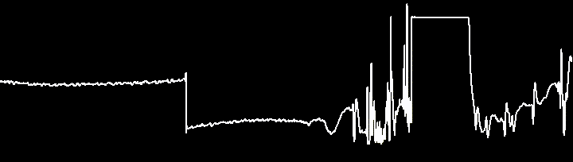
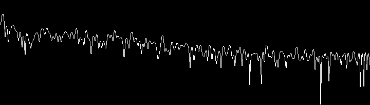
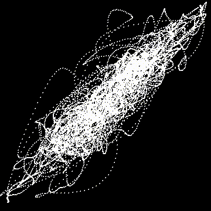
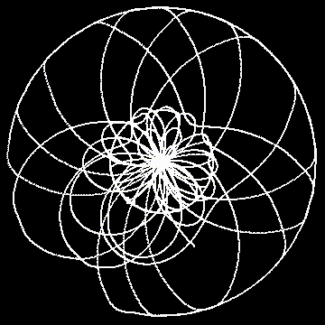
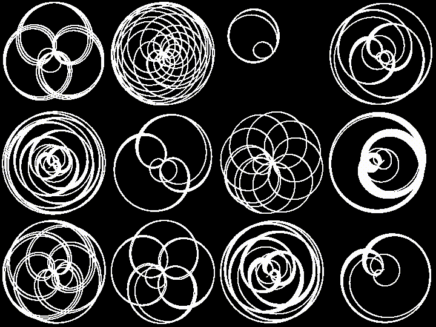
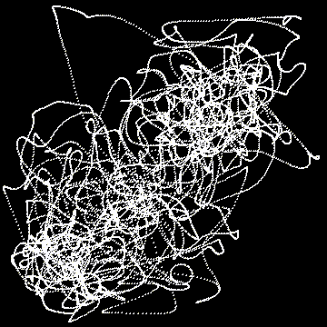
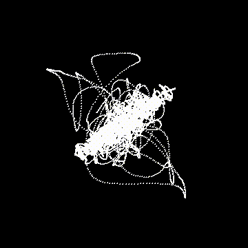

# LSaO Visualiser
by [Aaron F. Bianchi](https://aaronfbianchi.github.io/) 

Linear Spectrum and Oscilloscope Visualizer is an extremely fast audio visualization tool

This tool can export videos of a linear spectrum, tuned short waveform, long waveform, X/Y oscilloscope, vectorscope, polar oscilloscope, recurrence plot, Poincaré plot, Chladni plate simulator or delay embedding plot of a song. It supports multiple audio and video formats.

Coded to look as **violent**, **responsive**, **snappy** and **rough** as possible. It draws a white visualizer over a black background for further processing with a video editor of your preference.

Linear Spectrum:

 

Short Waveform:

 

Linear Spectrum (dB):

 

Spectrogram:

 

Long Waveform:

 

Stereo Oscilloscope:

 

Polar Vectorscope:

 

Mono Polar Oscilloscope:

 

Stereo Polar Oscilloscope (one audio source and various tunings):

 

Mono Polar Oscilloscope:

 

Stereo Polar Oscilloscope:

Linear Spectral Balance:

Recurrence Plot:

Poincaré Plot

Delay Embedding Plot:

Histogram Visualizer:

False Chladni Plate Visualizer:

Chladni Plate Visualizer:

Envelope Visualizer:

Bunch of demo videos
---------------------
* [Hellhacker](https://www.youtube.com/watch?v=upkUpTIws48) by Aaron F. Bianchi
* [Slaying With Portals](https://www.youtube.com/watch?v=IIGqghktYas) by Aaron F. Bianchi
* [The Forbidden Dance](https://www.youtube.com/watch?v=qKTOINiTxGw) by The Hamster Alliance
* [Nailgun](https://www.youtube.com/watch?v=buWPKEcAkw8) by Aaron F. Bianchi
* [Deathmatch EP](https://www.youtube.com/watch?v=_H94n6kc204) by Aaron F. Bianchi
* [Blip](https://youtu.be/unIQeniWOp0) by The Hamster Alliance
* [Death Itself](https://youtu.be/11eqIOSgt0w?si=JjFL0j3CZkbPQk2i) by Aaron F. Bianchi

Why?
---------------------
This small project started due to the omnipresence of logarithmic spectrum visualizers and the apparent absence of linear spectrum visualizers (apart from the one in After Effects, but who wants to install an Adobe product anyway).

Download
---------------------
You can download it [here](https://codeberg.org/aaronfbianchi/LSaO-visualizer/releases).

Installation
---------------------
You don't need to install it. Just double click the executable.

Live Audio Visualization
---------------------
**For Linux:**

You can select which audio stream you want to visualize with Pavucontrol. Just set that source as fallback in the "Input Devices" tab. 

- Set as fallback "Monitor" to visualize Desktop Audio.
- Set as fallback Internal Microphone or your audio interface for actual audio inputs.

**For Windows:**

- Search for "Sound settings"

- Advanced -> More sound settings

- For Desktop Audio, you can select which audio stream you want to visualize in the "Playback" tab by setting it as default.

- For live microphone input (or any other audio source like an audio interface), go to the "Recording" tab and double click on the device you want to use.

- In the "Listen" tab, check "Listen to this Device" and then press OK/Apply.

Things to know
---------------------
* The Windows releases of this software bundle FFmpeg (https://ffmpeg.org/). Nevertheless, if for any reason it's missing, it will try to use the FFmpeg in PATH if already installed. FFmpeg is licensed under the GNU General Public License version 3 (GPL v3). Prebuilt binaries used in this project are from Gyan.dev (https://www.gyan.dev/ffmpeg/builds/). The FFmpeg source code is available at https://ffmpeg.org/download.html#source

Tips if using on Windows
-------------------------
* The default Windows video player is not gonna play the exported videos correctly. Try another video player instead (Like VLC, for example). You'll be able to use the exported videos in any video editing software just fine, though.

Running from source
---------------------
Version 3.00 uses 'uv' as the library manager. To run this program, clone it and execute 'uv run src/main.py' in the command line.

Aditionally, if you want to create an executable from source, these libraries have worked for me:
* cx-freeze==8.7.1 (For Linux)
* pyinstaller>=6.22.3 (For Windows)

For creating an executable from Linux:

    uv run cxfreeze build_exe

For creating an executable from Windows:

    uv run pyinstaller --onefile --noupx --add-data resources/*:resources src/main.py
